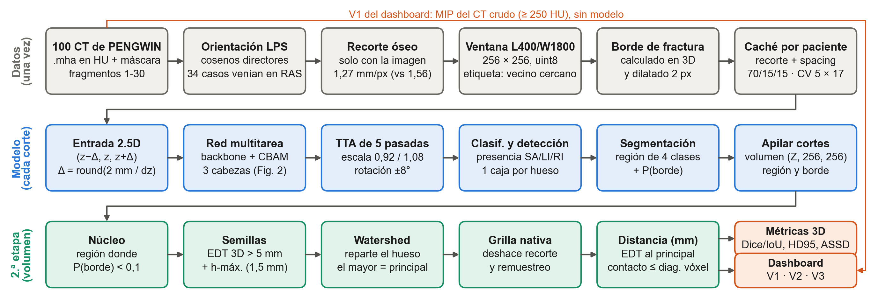
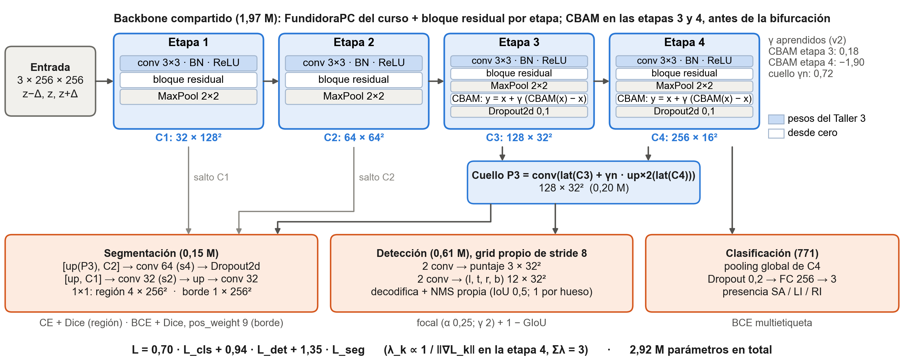
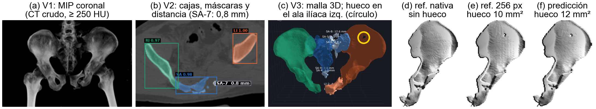
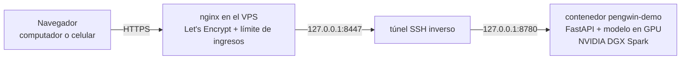

# PENGWIN: detección, segmentación y medición de fragmentos en fracturas pélvicas (CT)

**Integrantes**
> * Yáxul Santiago Cárdenas Hincapié
> * Nicolas Santiago Cuaran Sotelo
> * Juan Jose Orozco Lopez
> * David Felipe Martinez Viracacha

A partir de una tomografía (CT) de pelvis fracturada, el sistema detecta el sacro y los dos coxales, separa y colorea los fragmentos de cada hueso y mide en milímetros la distancia de cada fragmento secundario a su principal. Es una red multitarea 2.5D propia (backbone FundidoraPC extendido + CBAM, tres cabezas, grid y NMS propios) seguida de una segunda etapa sin aprendizaje que convierte región y borde en fragmentos. Proyecto Integrador Corte 2, Analítica de Datos, UAO 2026-2, sobre el dataset del reto PENGWIN (MICCAI 2024).

> **Uso exclusivamente académico.** No es un dispositivo médico, no está validado clínicamente y no debe usarse para apoyar decisiones quirúrgicas reales.

| | |
|---|---|
| Dashboard en vivo | **https://pengwin.80-241-217-130.nip.io** (pide usuario y clave) |
| Informe técnico | [`00_docs/Informe_PENGWIN.pdf`](00_docs/Informe_PENGWIN.pdf) (y `.docx`) |
| Pesos entrenados | [Release `v1.0-entrega`](https://github.com/Juanjoslo2/Analitica-de-datos-Proyecto-2-PENGWIN/releases/tag/v1.0-entrega) · se bajan con `python scripts/descargar_pesos.py` |
| Model cards | [`reports/model_cards/`](reports/model_cards/) (final, v2, base, sin_cbam, sin_tl) |
| Enunciado | [`00_docs/Proyecto_Corte2_PENGWIN.pdf`](00_docs/Proyecto_Corte2_PENGWIN.pdf) |

## Contenido

1. [Resultado final](#1-resultado-final)
2. [Cómo funciona](#2-cómo-funciona): pipeline de datos, modelo por bloques, qué se probó
3. [Estructura del repositorio](#3-estructura-del-repositorio)
4. [Instalación](#4-instalación)
5. [Reproducir el proyecto](#5-reproducir-el-proyecto), por niveles
6. [Dashboard](#6-dashboard)
7. [Despliegue](#7-despliegue)
8. [Entregables](#8-entregables)
9. [Limitaciones](#9-limitaciones)
10. [Flujo de trabajo en Git](#10-flujo-de-trabajo-en-git)

## 1. Resultado final

Test de 15 pacientes, medido una vez. Modelo `v2_last` + TTA de 5 pasadas + posproceso `edt_hmax` ([`configs/tuned.yaml`](configs/tuned.yaml)).

| Tarea | Métrica | Test | Objetivo | Cumple |
|---|---|---|---|---|
| Clasificación | F1 | 0,993 | ≥ 0,85 | sí |
| Clasificación | AUC | 0,999 | ≥ 0,85 | sí |
| Detección | IoU promedio | 0,919 | ≥ 0,65 | sí |
| Detección | mAP@0.50 | 0,980 | ≥ 0,65 | sí |
| Detección | mAP@[.50:.95] | 0,864 | ≥ 0,40 | sí |
| Segmentación de fragmento | Dice | 0,768 (IC95 0,702-0,827) | ≥ 0,85 | no |
| Segmentación de fragmento | IoU | 0,697 (IC95 0,636-0,753) | ≥ 0,70 | no concluyente |
| Opcional | HD95 / ASSD por fragmento | 11,7 / 3,3 mm | — | — |

- **Distancia de separación:** 22 de los 39 secundarios reales (56 %) se recuperan y tienen distancia comparable; error medio 1,96 mm, mediana 0,00 mm (2,32 mm en contacto, 0,75 mm separados).
- **Latencia por corte** (laptop con RTX 3060 e i7-11800H): sin TTA 7,7 ms en GPU y 66 ms en CPU; con TTA 33,8 ms y 309 ms (7,4 s por un volumen de 401 cortes en GPU).
- Los intervalos salen de un bootstrap por paciente (5000 réplicas). Con 15 pacientes, el 0,70 de IoU cae dentro del intervalo: no se puede afirmar que se cumpla ni que no. Detalle en el informe (Tabla V) y en `04_notebook/03_semana11.ipynb` §10.

## 2. Cómo funciona

### 2.1 Pipeline de datos



*Fig. 1 del informe. Arriba, la preparación que se hace una vez por caso y queda en caché; en el centro, la inferencia corte a corte; abajo, la segunda etapa sobre el volumen apilado, sin aprendizaje. El visualizador 1 lee el CT crudo y no pasa por el modelo.*

| Paso | Qué hace | Código |
|---|---|---|
| Lectura y orientación | `.mha` en HU; todos los volúmenes a LPS con los cosenos directores del header (34 de 100 venían en RAS), sin interpolar | `03_src/pengwin/data/data_loader.py` |
| Partición | 70/15/15 por paciente, la de menor SMD (0,155) entre 20 000 particiones; fija y con sha256 | `01_data/splits.json`, `data/create_splits.py` |
| Recorte, ventana y caché | recorte cuadrado alrededor del esqueleto calculado solo con la imagen (1,27 mm/px de mediana), ventana L400/W1800, 256 × 256; etiqueta por vecino más cercano | `data/preprocessing.py`, `data/slice_cache.py`, `scripts/build_slice_cache.py` |
| Objetivos por corte | entrada 2.5D (z−Δ, z, z+Δ) con Δ = round(2 mm / dz); cajas por hueso; borde de fractura 3D (6-vecindad) dilatado 2 px | `data/targets.py`, `data/dataset.py` |
| Inferencia por corte | red multitarea + TTA de 5 pasadas (identidad, escala 0,92/1,08, rotación ±8°) que promedia región y borde | `inference/volume.py` |
| Segunda etapa | núcleo = región con P(borde) < 0,1; semillas a más de 5 mm del borde (EDT 3D con el spacing) más h-máximas (h = 1,5 mm); watershed; el mayor es el principal | `postprocess/instances.py` |
| Distancia | d(S) = mín. de la EDT del principal sobre el secundario, en la grilla nativa y con el spacing del header; contacto si d ≤ diagonal del vóxel | `measurement/separation.py` |
| Métricas | por fragmento en 3D con emparejamiento húngaro dentro de cada hueso; HD95/ASSD | `evaluation/fragment_metrics.py`, `evaluation/det_metrics.py` |

### 2.2 Modelo por bloques



*Fig. 2 del informe, como está en `models/backbone.py` y `models/heads.py`. En cada etapa el CBAM actúa después del MaxPool, así que las tres cabezas leen mapas que ya pasaron por él. Tensores en canales × alto × ancho.*

- **Backbone (1,97 M parámetros):** las cuatro etapas de FundidoraPC (32-64-128-256 canales) con un bloque residual por etapa cuya última BN arranca en cero, así que con los pesos del Taller 3 cargados la red reproduce la salida original. Solo las conv+BN de FundidoraPC se transfieren; lo demás parte de cero.
- **CBAM** (canal y espacial, implementación propia en `models/cbam.py`) en las etapas 3 y 4, antes de la bifurcación, mezclado con la identidad: y = x + γ(CBAM(x) − x), con γ aprendible desde 0.
- **Cuello** P3 = conv(lat(C3) + γₙ · up×2(lat(C4))), 128 × 32 × 32 (0,20 M).
- **Clasificación** (771 parámetros): pooling global de C4 → presencia de SA, LI y RI.
- **Detección** (0,61 M): anchor-free sobre P3 (stride 8): por celda y hueso, un puntaje y las distancias (l, t, r, b), con pérdida focal y 1 − GIoU; NMS propia por clase (`detection/grid.py`, `detection/nms.py`).
- **Segmentación** (0,15 M): decodificador con saltos a C2 y C1 que da la región de 4 clases y el borde de fractura a 256 × 256.
- **Pérdida:** L = 0,70 · L_cls + 0,94 · L_det + 1,35 · L_seg. Los λ se calibraron por norma de gradiente sobre la etapa 4 (λₖ ∝ 1/‖∇Lₖ‖, Σλ = 3) con `scripts/calibrate_lambdas.py`; quedan en `reports/lambdas.json`.
- **Entrenamiento:** AdamW (lr 3·10⁻⁴, coseno), batch 8, precisión mixta, 40 épocas, Dropout2d 0,1, semilla 42, aumentación sin volteo (cambiaría izquierda por derecha). Prueba de correctitud: la red memoriza 8 cortes en 500 pasos.

### 2.3 Qué se probó

Antes de comparar variantes se midió el ruido de semilla: σ = 0,0097 en Dice por fragmento. Cada candidato se juzgó contra ese ruido con validación cruzada por paciente (5 folds de 17), sin usar el test. Solo lo superaron la separación por distancia, la TTA de 5 pasadas y el rescate de semillas por h-máxima (+0,047 de Dice por fragmento, t = 4,1, 5 de 5 folds). Con o sin CBAM y con o sin transfer learning el Dice no cambia (CBAM se mantiene porque el enunciado lo exige). El peso y la dilatación del borde, el lr, el dropout, la aumentación fuerte, repetir cortes con secundarios, frenar o congelar el backbone, EMA, L2, un decodificador más ancho, U-Net++ y el cierre morfológico del hueco quedaron dentro del ruido o empeoraron. El ensamble de varios modelos sí mejoraba, pero se descartó porque el enunciado pide un mismo backbone. Las tablas completas están en el informe (secciones IV y V) y en los notebooks `02_semana10` y `04_semana11_borde`.

## 3. Estructura del repositorio

```
00_docs/          enunciado, informe (PDF y Word) y figuras de este README
01_data/          splits.json (partición fija) y eda_metadata.csv; aquí van los .mha (no se versionan)
02_auditoria/     auditoría inicial de los archivos (semana 8, necesita los .mha)
03_src/pengwin/   el paquete: data, models, detection, losses, training, inference,
                  postprocess, measurement, evaluation, visualization, eda, utils
04_notebook/      notebooks por semana (leen reports/, corren sin datos ni GPU)
05_app/           dashboard: FastAPI + una página con los 3 visualizadores, Dockerfile
06_tests/         pytest con phantoms sintéticos (los que necesitan datos se omiten solos)
configs/          base.yaml (modelo v2), tuned.yaml (inferencia final), ablaciones y tuning/ (una por candidato de la CV)
reports/          todo lo medido: train/, eval/, fragments/, latency/, sam/, tuning/, model_cards/,
                  figures/ y decisiones_de_diseno.md (bitácora de diseño por semana)
scripts/          entrenamiento, evaluación, ajuste por CV, latencia, model cards, descarga de pesos
checkpoints/      pesos .pth (no se versionan; ver la sección 5)
```

## 4. Instalación

Python 3.12. En Windows (PowerShell):

```powershell
git clone https://github.com/Juanjoslo2/Analitica-de-datos-Proyecto-2-PENGWIN.git
cd Analitica-de-datos-Proyecto-2-PENGWIN
py -3.12 -m venv .venv
.\.venv\Scripts\Activate.ps1
pip install -r requirements.txt     # torch 2.10.0 + CUDA 12.8; las mismas ruedas corren en CPU
pip install -e .                    # hace importable el paquete `pengwin` (03_src/pengwin)
python -m pytest                    # 06_tests, con phantoms sintéticos; no necesita datos ni GPU
```

En Linux o macOS es igual con `python3.12 -m venv .venv` y `source .venv/bin/activate`.

## 5. Reproducir el proyecto

Cuatro niveles, de menos a más costoso. Cada uno sirve por sí solo.

### Nivel 1: ver los resultados (sin datos ni GPU)

Los notebooks leen lo que quedó guardado en `reports/` y corren de principio a fin en un clon recién bajado. Orden de lectura:

| # | Notebook | Semana | Qué muestra |
|---|---|---|---|
| 1 | `04_notebook/01_eda_pengwin.ipynb` | 8 | EDA orientado a decisiones: orientación, resolución, HU, metal, fragmentos, distancias, balance de la partición |
| 2 | `04_notebook/00_sustentacion_pengwin.ipynb` | 9 | arquitectura, grid y NMS, pérdida y λ, prueba de overfit, entrenamiento base y ablación |
| 3 | `04_notebook/02_semana10.ipynb` | 10 | pipeline completo, separación por distancia, SAM, latencia; ajuste por validación cruzada y modelo final |
| 4 | `04_notebook/03_semana11.ipynb` | 11 | dashboard, hueco del ala ilíaca, matriz de confusión, 5 peores casos, distancia predicha contra real, HD95/ASSD, fuga de datos e incertidumbre del test |
| 5 | `04_notebook/04_semana11_borde.ipynb` | 11 | sobreajuste de la cabeza de borde: L2, decodificador más ancho y U-Net++ |
| — | `02_auditoria/AUDITORIA_PENGWIN.ipynb` | 8 | auditoría de los archivos crudos (este sí necesita los `.mha` en `01_data/`) |

Si además están el caché y los pesos, `00_sustentacion` y `02_semana10` muestran predicciones en vivo; el caché se indica con `$env:PENGWIN_CACHE_DIR = "D:/PENGWIN/data_processed"`.

### Nivel 2: usar el modelo entregado

```powershell
python scripts/descargar_pesos.py                    # los 7 .pth del Release a checkpoints/ (~118 MB, verifica sha256)
python scripts/descargar_pesos.py --modelos v2_last  # o solo el modelo final (35 MB)
```

Con eso ya corre el dashboard en local (sección 6) y se puede subir cualquier CT de pelvis en `.mha`, `.nii`, `.nii.gz` o `.nrrd`, o una serie de cortes PNG, JPEG o DICOM.

### Nivel 3: reproducir las cifras de test

Datos: [PENGWIN Task 1 en Zenodo](https://zenodo.org/records/10927452) (3 `.zip`, 7,6 GB; ~32 GB descomprimidos). Se descomprimen en `01_data/PENGWIN_CT_train_images_part1`, `01_data/PENGWIN_CT_train_images_part2` y `01_data/PENGWIN_CT_train_labels`. Si el repositorio está en OneDrive, conviene dejar datos y caché (~6 GB) en otro disco; los scripts reciben `--data-dir` y `--cache-dir`. La partición ya está en `01_data/splits.json`: no hay que regenerarla.

```powershell
$DATA  = "01_data"            # o D:/PENGWIN/01_data
$CACHE = "data_processed"     # o D:/PENGWIN/data_processed

# caché de cortes 256 × 256 con el borde 3D (una vez; reanudable)
python scripts/build_slice_cache.py --data-dir $DATA --cache-dir $CACHE

# clasificación y detección (reports/eval/v2_last_test.json) y prueba de estrés de la detección
python scripts/evaluate.py --cache-dir $CACHE --ckpt checkpoints/v2_last/best.pth
python scripts/stress_detection.py --ckpt checkpoints/v2_last/best.pth --cache-dir $CACHE

# fragmentos con la configuración final (TTA y edt_hmax salen de tuned.yaml), HD95/ASSD y distancia en mm
python scripts/evaluate_fragments.py --ckpt checkpoints/v2_last/best.pth --cache-dir $CACHE --data-dir $DATA --split test --config configs/tuned.yaml --tag _tuned_superficie --surface --save-dir D:/PENGWIN/pred_tuned

# intervalos por bootstrap de pacientes y auditoría de fuga, matriz de confusión, 5 peores casos
python scripts/auditoria_fugas.py --data-dir $DATA --cache-dir $CACHE
python scripts/confusion.py --ckpt checkpoints/v2_last/best.pth --cache-dir $CACHE
python scripts/peores_casos.py --pred-dir D:/PENGWIN/pred_tuned --data-dir $DATA --report reports/fragments/v2_last_test_tuned_superficie

# ablación en test (modelos de la semana 9), Grad-CAM con y sin CBAM
python scripts/evaluate.py --cache-dir $CACHE --ckpt checkpoints/base/best.pth checkpoints/sin_cbam/best.pth checkpoints/sin_tl/best.pth
python scripts/gradcam.py --cache-dir $CACHE --cases 075 069 019

# SAM ViT-B como línea base (pesos oficiales: https://dl.fbaipublicfiles.com/segment_anything/sam_vit_b_01ec64.pth)
python scripts/sam_baseline.py --ckpt checkpoints/base/best.pth --cache-dir $CACHE --sam-ckpt D:/PENGWIN/sam/sam_vit_b_01ec64.pth

# latencia por corte en GPU y CPU, sin y con TTA
python scripts/latency.py --ckpt checkpoints/v2_last/best.pth --cache-dir $CACHE
python scripts/latency.py --ckpt checkpoints/v2_last/best.pth --cache-dir $CACHE --tta

# model cards a partir de los reportes
python scripts/model_cards.py
```

Cada script escribe en `reports/` encima de lo entregado, así que `git diff reports/` muestra si algo cambió.

### Nivel 4: reentrenar

Entrenar es lo único que necesita GPU de verdad: 40 épocas son horas por modelo.

**Modelo final (`v2`).** `reports/lambdas.json` ya trae los λ con los que se entrenó (`calibrate_lambdas.py` los recalcula y sobrescribe ese archivo).

```powershell
python scripts/overfit_batch.py --cache-dir $CACHE           # prueba de correctitud: memoriza 8 cortes
python scripts/calibrate_lambdas.py --cache-dir $CACHE       # opcional: recalibra los λ
python scripts/train.py --cache-dir $CACHE --name v2         # 40 épocas -> checkpoints/v2/best.pth y last.pth
New-Item -ItemType Directory -Force checkpoints/v2_last | Out-Null
Copy-Item checkpoints/v2/last.pth checkpoints/v2_last/best.pth   # se entrega la última época (39)
```

**Modelos de la semana 9 (`base`, `sin_cbam`, `sin_tl`).** Se entrenaron antes de los cambios de `v2` (borde 2D, sin γ ni Dropout2d, otros λ), así que se reproducen con el código del commit `3359bb9`. Su config efectiva quedó en `reports/train/<nombre>.json` y coincide con la de ese commit.

```powershell
git worktree add --detach ../pengwin-semana9 3359bb9
Copy-Item checkpoints/fundidora_taller3.pth ../pengwin-semana9/checkpoints/
cd ../pengwin-semana9
python scripts/build_slice_cache.py --data-dir D:/PENGWIN/01_data --cache-dir D:/PENGWIN/data_processed_s9   # rutas absolutas: es otra carpeta
python scripts/train.py --cache-dir D:/PENGWIN/data_processed_s9 --name base
python scripts/train.py --cache-dir D:/PENGWIN/data_processed_s9 --name sin_cbam --config configs/ablation_no_cbam.yaml
python scripts/train.py --cache-dir D:/PENGWIN/data_processed_s9 --name sin_tl --config configs/ablation_scratch.yaml
```

**Validación cruzada del ajuste (semanas 10-11).** Los folds están en `reports/tuning/cv_folds.json` (`scripts/cv_folds.py`) y cada corrida tiene su config en `configs/tuning/`. Para un candidato y un fold (el cribado usa solo el fold 0 y 12 épocas; la confirmación, los 5 folds y 20 épocas):

```powershell
python scripts/calibrate_lambdas.py --config configs/tuning/c00_base.yaml --cache-dir $CACHE --folds-file reports/tuning/cv_folds.json --fold 0 --out reports/tuning/lambdas/cv_c00_base_e20_f0.json
python scripts/train.py --config configs/tuning/c00_base.yaml --cache-dir $CACHE --name cv_c00_base_e20_f0 --folds-file reports/tuning/cv_folds.json --fold 0 --epochs 20 --lambdas-file reports/tuning/lambdas/cv_c00_base_e20_f0.json
python scripts/cv_predict.py --ckpt checkpoints/cv_c00_base_e20_f0/last.pth --cache-dir $CACHE --folds-file reports/tuning/cv_folds.json --fold 0 --out-dir D:/PENGWIN/oof/cv_c00_base_e20_f0 --tta
```

Con los 5 folds, el posproceso se evalúa sobre las predicciones fuera de fold y los resultados se consolidan en `reports/tuning/ajuste_*`, que es lo que leen los notebooks:

```powershell
python scripts/tune_postprocess.py --name pp_c00_base --cache-dir $CACHE --oof "D:/PENGWIN/oof/cv_c00_base_e20_f{fold}" --folds-file reports/tuning/cv_folds.json --grid "seed_depth_mm=5" --base "method=edt_hmax;edge_threshold=0.1;hmax_h_mm=1.5;seed_min_cm3=0.02;edge_weight=5"
python scripts/consolidar_ajuste.py
```

Nota: con `persistent_workers` la época no llega a los procesos del DataLoader, así que cada corte recibe la misma aumentación en todas las épocas. Así se entrenaron todos los modelos y el código se deja igual para que reproduzca lo entregado; está declarado como limitación en el informe (Tabla VIII).

## 6. Dashboard

`05_app/` es una aplicación FastAPI con una sola página y los tres visualizadores del enunciado:

1. **Volumen crudo:** MIP del CT con umbral de 250 HU, sin modelo.
2. **Corte a corte:** slider con cajas, máscaras coloreadas por hueso y la distancia escrita sobre cada secundario.
3. **Reconstrucción 3D:** marching cubes por fragmento + Plotly Mesh3d, con la distancia junto a cada etiqueta.



*Fig. 4 del informe, caso 075 de test. (c) muestra un hueco en el ala ilíaca que no es una fractura: el ala mide 0,85-1,7 mm y la etiqueta remuestreada a 256 px lo abre (d-f).*

Acepta un volumen `.mha`, `.nii`, `.nii.gz` o `.nrrd`, o cortes sueltos PNG, JPEG o DICOM (varios archivos, una carpeta o un `.zip`). Con cortes, el volumen se arma en el servidor (`05_app/cortes.py`): el orden sale de la posición DICOM, del `SliceLocation`, del número del nombre o, si no hay nada de eso, del parecido entre cortes vecinos. Un PNG no dice qué extremo es la cabeza; eso lo decide el modelo (el sacro queda por encima de los coxales). Para probarlo con un caso conocido: `python 05_app/exportar_cortes.py <caso>.mha <carpeta> --formato png|png16|jpg|dicom [--desordenar] [--zip]`. Los volúmenes se suben en trozos de 8 MB comprimidos con gzip, cuatro a la vez por WebSocket.

### 6.1 En local (Windows)

```powershell
python scripts/descargar_pesos.py --modelos v2_last
cd 05_app
python usuarios.py crear demo                        # pide la clave dos veces (o --generar para una al azar)
python preparar_ejemplos.py --data-dir D:/PENGWIN/01_data --cases 075 097 069    # opcional: casos de ejemplo
$env:PENGWIN_COOKIE_INSEGURA = "1"                   # solo en http://localhost: la cookie normal exige HTTPS
uvicorn app:app --host 127.0.0.1 --port 8780
```

Se abre http://127.0.0.1:8780 y se entra con el usuario creado. Usa la GPU si hay; si no, corre en CPU (más lento: la TTA son 5 pasadas por corte). En una laptop con RTX 3060, preparar el caso 075 tarda unos 35 s.

### 6.2 En un servidor con GPU (Docker)

La imagen parte de `nvcr.io/nvidia/pytorch:25.09-py3`, que sirve en aarch64 con CUDA 13 (NVIDIA DGX Spark) y en x86 con NVIDIA. Se construye desde la raíz del repositorio; pesos, usuarios, trabajos y ejemplos quedan fuera de la imagen, en volúmenes.

```bash
docker build -f 05_app/Dockerfile -t pengwin-demo .
mkdir -p ~/pengwin_demo/datos/{ejemplos,trabajos,usuarios}
docker run -d --name pengwin-demo --gpus all --restart unless-stopped -p 127.0.0.1:8780:8780 \
  -v "$PWD/checkpoints:/w/checkpoints:ro" \
  -v ~/pengwin_demo/datos/ejemplos:/datos/ejemplos \
  -v ~/pengwin_demo/datos/trabajos:/datos/trabajos \
  -v ~/pengwin_demo/datos/usuarios:/datos/usuarios \
  -v /ruta/a/01_data:/datos/pengwin_ct:ro \
  -e PENGWIN_EJEMPLOS=/datos/ejemplos -e PENGWIN_TRABAJOS=/datos/trabajos \
  -e PENGWIN_USUARIOS=/datos/usuarios/usuarios.db -e PENGWIN_CTS=/datos/pengwin_ct \
  pengwin-demo
docker exec -it pengwin-demo python usuarios.py crear <usuario>
docker exec pengwin-demo python preparar_ejemplos.py --data-dir /datos/pengwin_ct --cases 075 097 069
```

El volumen de `01_data` es opcional: con él, si alguien sube la máscara de un caso de PENGWIN en lugar del CT, el dashboard analiza el CT de ese caso y usa la máscara como referencia. Si el contenedor se va a abrir por `http://` sin un proxy con HTTPS, hay que añadir `-e PENGWIN_COOKIE_INSEGURA=1`.

### 6.3 Seguridad

- Usuario y clave en SQLite con scrypt (`05_app/seguridad.py`); tres claves equivocadas seguidas bloquean el perfil. Se administra desde el servidor: `python usuarios.py crear|clave|desbloquear|bloquear|eliminar|listar|eventos`.
- Cada trabajo subido pertenece a su usuario y se borra a las 6 h; los ejemplos los ven todos.
- Los archivos se validan por contenido antes de llegar al modelo (`05_app/validacion.py`): solo volúmenes de un archivo (un `.mha` o `.nrrd` que apunte a otro archivo del servidor se rechaza), dimensiones acotadas antes de descomprimir, cortes PNG/JPEG/DICOM reales y límites de número, peso y tamaño descomprimido en lotes y `.zip`. El nombre de un archivo nunca se usa como ruta. Si se sube algo que no es un CT (por ejemplo, una máscara), la página lo dice.
- Peticiones que cambian algo deben venir del mismo origen; cookie `HttpOnly`, `SameSite=Strict` y `Secure`.

## 7. Despliegue

El contenedor corre en una NVIDIA DGX Spark (GPU GB10) y se publica con HTTPS a través del VPS del equipo:



El enunciado propone un túnel de Cloudflare. Desde la red de la GPU no fue posible porque bloquea el puerto de salida que usa `cloudflared` (7844), así que se usó un túnel SSH inverso hacia un VPS con nginx. Las dos opciones, para quien lo replique:

**A. Túnel de Cloudflare** (lo más simple, si la red lo permite). Da una URL `https://*.trycloudflare.com` con HTTPS, así que la cookie segura funciona sin cambios:

```bash
cloudflared tunnel --url http://127.0.0.1:8780
```

**B. Túnel SSH inverso + nginx (lo desplegado).** En el equipo con GPU, un servicio systemd mantiene el túnel con una llave dedicada a un usuario sin shell del VPS:

```ini
# /etc/systemd/system/pengwin-demo-tunel.service
[Unit]
Description=PENGWIN demo: tunel inverso hacia el VPS
After=network-online.target docker.service
Wants=network-online.target

[Service]
ExecStart=/usr/bin/ssh -N -i /etc/pengwin-demo/tunnel_key -o IdentitiesOnly=yes \
  -o ExitOnForwardFailure=yes -o ServerAliveInterval=20 -o ServerAliveCountMax=3 \
  -R 127.0.0.1:8447:127.0.0.1:8780 <usuario-tunel>@<ip-del-vps>
Restart=always
RestartSec=5

[Install]
WantedBy=multi-user.target
```

En el VPS, un `server` de nginx propio con certificado de Let's Encrypt (`certbot`) hace de proxy a `127.0.0.1:8447`. Lo que no puede faltar:

```nginx
limit_req_zone $binary_remote_addr zone=pengwin_login:1m rate=10r/m;

server {
    listen 443 ssl http2;
    server_name <dominio>;
    # ssl_certificate y ssl_certificate_key: los que deja certbot
    client_max_body_size 24m;                 # trozos de 8 MB
    proxy_read_timeout 300s;

    location = /api/login {                   # freno de fuerza bruta además del bloqueo por perfil
        limit_req zone=pengwin_login burst=5 nodelay;
        proxy_pass http://127.0.0.1:8447;
        proxy_set_header Host $host;
        proxy_set_header X-Forwarded-For $proxy_add_x_forwarded_for;
        proxy_set_header X-Forwarded-Proto $scheme;
    }
    location ~ ^/api/subida/[a-z0-9_-]+/ws$ { # la subida va por WebSocket
        proxy_pass http://127.0.0.1:8447;
        proxy_http_version 1.1;
        proxy_set_header Upgrade $http_upgrade;
        proxy_set_header Connection "upgrade";
        proxy_set_header Host $host;
        proxy_set_header X-Forwarded-Proto $scheme;
    }
    location / {
        proxy_pass http://127.0.0.1:8447;
        proxy_set_header Host $host;
        proxy_set_header X-Forwarded-For $proxy_add_x_forwarded_for;
        proxy_set_header X-Forwarded-Proto $scheme;
        proxy_request_buffering off;
        client_body_buffer_size 8m;
    }
}
```

La subida va en varios WebSocket porque cada uno es una conexión TCP propia: por HTTP/2 todo viaja en una sola conexión y, con el VPS en Europa, un trozo de 8 MB subía a 0,3 MB/s. Con 4 conexiones y gzip, un CT de 420 MB pasó de ~19 min a ~33 s. El caso 019 (184 MB) se procesa en 16 s.

## 8. Entregables

| Entregable (§7 del enunciado) | Dónde |
|---|---|
| Repositorio con historial y PR | este repositorio; sección 10 |
| Pesos `.pth` de cada modelo | [Release `v1.0-entrega`](https://github.com/Juanjoslo2/Analitica-de-datos-Proyecto-2-PENGWIN/releases/tag/v1.0-entrega) (7 archivos + `SHA256SUMS.txt`); `scripts/descargar_pesos.py` |
| Pipeline reproducible | `requirements.txt`, `pyproject.toml`, `configs/` (semilla 42), sección 5 de este README |
| Dashboard en vivo (computador y celular) | https://pengwin.80-241-217-130.nip.io · código en `05_app/`; secciones 6 y 7 |
| Latencia en GPU y CPU | `reports/latency/`, `scripts/latency.py`; `03_semana11` §3 |
| Model card de cada modelo | `reports/model_cards/` (final, v2, base, sin_cbam, sin_tl), generados con `scripts/model_cards.py` |
| `IA_USAGE.md` | [`IA_USAGE.md`](IA_USAGE.md) |
| Informe (mini-paper) | `00_docs/Informe_PENGWIN.pdf`: decisiones, ablación CBAM/TL, matriz de confusión, 5 peores casos, distancia predicha contra real |
| Ablación con/sin CBAM y con/sin TL | test: `reports/eval/` y `00_sustentacion` §10; CV: `02_semana10` §16 |
| Línea base SAM | `reports/sam/`, `scripts/sam_baseline.py`; `02_semana10` §7 |
| Matriz de confusión, 5 peores casos, distancia predicha contra real | `03_semana11` §4-6; `reports/eval/confusion_test.json`, `reports/eval/peores_casos.json` |
| Decisiones de diseño | informe y notebooks; `reports/decisiones_de_diseno.md` es la bitácora que se fue escribiendo semana a semana (las cifras finales son las del informe y los notebooks) |

## 9. Limitaciones

- **Fragmentos en contacto.** La cabeza de borde marca solo el 16 % de la superficie de fractura; cuando un secundario toca a su principal, se fusionan o se cortan por otro sitio. Es la razón principal de que el Dice por fragmento quede en 0,768.
- **Grilla de 256 px.** Láminas y grietas de 1-2 mm quedan por debajo de un píxel de ~1,3 mm: 102 de los 300 principales ganan túneles al remuestrear (el hueco del ala ilíaca en la malla 3D).
- **Fragmentos de más.** Se predicen más fragmentos de los reales; la métrica por fragmento real no los castiga, pero se ven en la malla.
- **Test pequeño y un solo conjunto.** 15 pacientes de test (la meta de IoU queda no concluyente) y 100 CT de un mismo dataset, sin validación externa.

La lista completa, con su evidencia, está en el informe (Tabla VIII) y en `reports/model_cards/final.md`.

## 10. Flujo de trabajo en Git

El enunciado pide historial de commits y Pull Requests por integrante, `main` protegida y merge solo tras revisión.

- **Proteger `main`** (lo hace el dueño del repositorio): *Settings → Branches → Add branch ruleset* sobre `main` con *Require a pull request before merging* (1 aprobación), *Require status checks to pass* (`tests / pytest`), *Block force pushes* y sin bypass para administradores.
- **Una rama por tarea** desde `main` actualizado (`feat/…`, `fix/…`, `docs/…`); el PR lo aprueba otro integrante y el check `tests` (`.github/workflows/tests.yml`) debe estar en verde.
- **Nunca subir** datos, pesos `.pth` (van al Release) ni notas `.md` personales: el `.gitignore` solo deja pasar `README.md`, `IA_USAGE.md` y `reports/**/*.md`.
